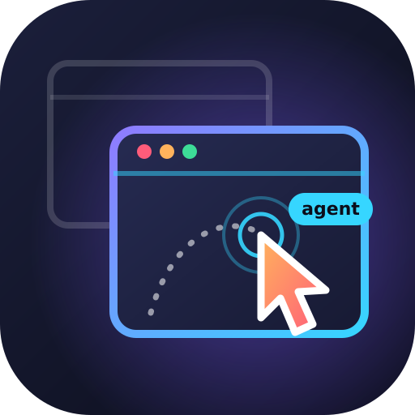
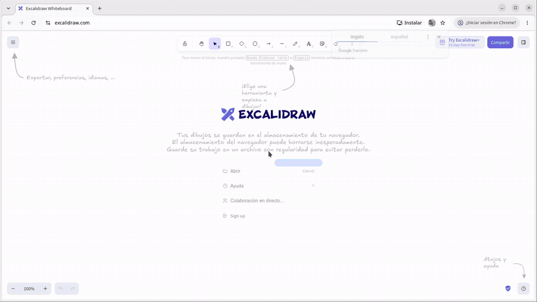

<p align="center">
  
</p>

# agent-desktop-linux-cursor

An agent skill, Claude Code plugin and command-line tool (`adc`) that gives an AI agent its own
isolated Linux desktop. The agent operates real applications with a visible cursor, while the user
keeps working undisturbed on another workspace.



*Recorded with `examples/excalidraw-demo.sh`: the agent draws on its private display while the
user's pointer and workspace remain untouched.*

## Features

- **Private display.** A Xephyr display embedded in a window on the agent's own GNOME workspace
  gives the agent its own pointer, keyboard focus and clipboard. Windows never appear on the
  user's workspace and never take the user's focus.
- **Isolation.** Applications run on a private D-Bus session restricted to an allow-list of
  services (accessibility, dconf, gvfs), a private accessibility bus and isolated XDG directories.
  Single-instance applications and notifications cannot leak onto the user's desktop.
- **Built-in accessibility engine.** `adc snapshot` lists the interface as `role "name" @ref`;
  `click`, `type`, `set-value`, `select`, `check`, `expand`, `find`, `wait` and `get` act on those
  references. Works with GTK 3/4, Qt, Chrome and Electron. No external CLI or Node.js needed.
- **Human-like input.** The pointer glides to each element before acting; typing uses the real
  keyboard, so web pages receive genuine input events. Accents, `ñ`, emoji and line breaks work.
- **Vision.** `adc see` captures the private display with a labelled coordinate grid for canvases,
  games and anything without an accessibility tree.
- **Agent cursor.** A click-through overlay shows the agent's pointer, an intent label, click
  ripples, element outlines and a typing caret, with a distinct colour per agent.
- **Persistent browser profiles.** Chrome runs with agent-owned profiles that keep site sessions.
- **User hand-off.** `adc ask-user` raises a system notification for sign-ins, captchas and 2FA.
  The user is taken to the agent workspace, completes the step and is returned where they were.
- **Recording.** Sessions are recorded to MP4 without the user watching the agent workspace.
- **Shared mode.** Optionally drive applications already open on the user's desktop, headless,
  with a focus guard.

## Install

As a Claude Code plugin (puts `adc` on the PATH automatically):

```bash
claude plugin marketplace add Ismael-Sallami/skills
claude plugin install agent-desktop-linux-cursor@sallami-skills
```

As a skill for any agent (Claude Code, Codex, Cursor, Gemini CLI...):

```bash
npx skills add Ismael-Sallami/agent-desktop-linux-cursor
# or manually:
git clone https://github.com/Ismael-Sallami/agent-desktop-linux-cursor.git ~/.claude/skills/agent-desktop-linux-cursor
ln -s ~/.claude/skills/agent-desktop-linux-cursor/scripts/adc ~/.local/bin/adc
```

Then check the machine:

```bash
adc doctor        # lists missing packages and prints the apt install line
```

## Requirements

- Linux with an X11 session (tested on Ubuntu 24.04, GNOME Shell 46). Wayland is not supported.
- Python 3 with PyGObject (AT-SPI, GTK 3) and these packages:

```bash
sudo apt install xserver-xephyr openbox picom xdotool wmctrl x11-utils x11-xserver-utils \
  x11-xkb-utils xclip imagemagick ffmpeg libnotify-bin python3-gi gir1.2-atspi-2.0 gir1.2-gtk-3.0
```

- Google Chrome or Chromium for `adc browser`.

## Usage

```bash
adc start --nested --record ~/Videos/session.mp4
adc browser "https://www.linkedin.com/jobs/" --name linkedin
adc ask-user "Please sign in to LinkedIn"        # only needed once per profile
adc snapshot --app chrome -i --compact
adc click @3fa1:e12 --label "Open job offer"
adc see --region 600,130,1000,260 --scale 0.5
adc run gnome-text-editor
adc write "Summary of the results" --target "Text Editor"
adc key ctrl+s
adc stop
```

Run `adc --help` for the complete command list. A recorded demonstration is available in
`examples/excalidraw-demo.sh`.

## Modes

| | Nested (`adc start --nested`) | Shared (`adc start`) |
|---|---|---|
| Display | Private Xephyr display on the agent workspace | User's X server, agent workspace |
| Input | Real pointer and keyboard of the private display | Headless accessibility actions only |
| Isolation | Complete | Focus guard |
| Vision and recording | Yes | No |
| Existing user applications | Not reachable | Reachable |

## Safety

- The agent never uses the user's pointer, keyboard or clipboard, and never switches the user's
  workspace.
- In shared mode, focus changes are refused unless the user explicitly allows them with
  `ADC_ALLOW_PHYSICAL=1`.
- Credentials are always entered by the user through `adc ask-user`.
- Agent browser profiles are stored in `~/.local/share/adc/browsers` with mode `0700`. Cookies
  are encrypted with Chrome's basic password store rather than the system keyring, so the
  protection of these profiles relies on file permissions.

## adc Pro

**Agent Desktop for Linux Pro** is available on Agensi: [Agensi Storefront](https://www.agensi.io/creators/ismael) · [Agensi Skills Catalog](https://www.agensi.io/skills).

It is a paid edition with features for heavier production automation:

| | Free | Pro |
|---|:-:|:-:|
| Private desktop, accessibility engine, vision, input, browser, hand-off, recording | ✓ | ✓ |
| Set-of-marks screenshots (`marks`, `click-mark`) | | ✓ |
| OCR: `find-text`, `click-text`, `wait-text` | | ✓ |
| Screen waits: `wait-stable`, `wait-change` | | ✓ |
| Guard for outward actions (send, pay, delete) | | ✓ |
| Macros with variables (`macro record/play`) | | ✓ |
| Journal and HTML session report, GIF export | | ✓ |
| Parallel isolated sessions (`ADC_SESSION`) | | ✓ |
| MCP server (`adc mcp`) for any MCP client | | ✓ |

## License

MIT. See [LICENSE](LICENSE). Earlier versions built on
[agent-desktop](https://github.com/vercel-labs/agent-desktop); since 2.0 `adc` ships its own
accessibility engine.
